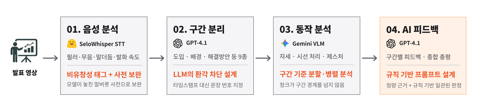
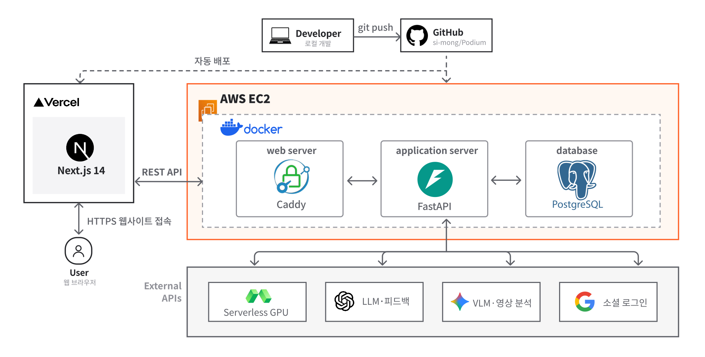

<div align="center">

# Podium
2026 CBNU CapstoneDesign
### **발표 연습, AI와 함께 혼자서도 쉽게!**

발표 영상 하나로 음성·자세·시선·제스처까지<br/>
**구간별로 분석하고 회차마다 성장 추이를 보여주는** AI 발표 코치

</div>

---

## 프로젝트 소개

### 배경

> "발표 연습은 했는데, 뭘 고쳐야 할지 모르겠어요."

발표는 누구나 하지만, 제대로 피드백받을 기회는 거의 없습니다.<br/>
혼자 영상을 다시 봐도 **무엇이 문제인지** 짚어내기 어렵고, 매번 누군가에게 부탁할 수도 없습니다.

### 목표

**Podium은 그 자리를 대신합니다.**<br/>
영상 한 편을 업로드하면 AI 코치가 발표 전체를 다시 보고, **구간별로 무엇을 잘했고 무엇을 고쳐야 하는지** 알려줍니다. 연습할수록 성장이 데이터로 쌓이는 경험을 제공합니다.

### 핵심 기능

#### 1. 멀티모달 분석
업로드하면 끝. 음성·언어·동작을 동시에 분석합니다.

| 영역 | 분석 항목 |
|---|---|
| 🗣️ **음성** | 발화 속도(WPM) · 무음 구간 · 필러 단어 ("음", "어") |
| 📝 **언어** | STT 기반 문장 분리 · 의미 단위 구간 분리 |
| 👁️ **시선·자세** | 카메라 응시율 · 자세 안정성 |
| 🤲 **제스처** | 손동작 활용도 · 불필요한 반복 동작 |

#### 2. 구간별 분석과 피드백
발표를 의미 단위로 자동 분할하고, **각 구간마다 발표 습관 결과**와 개선 코멘트를 제공합니다.

#### 3. 회차별 성장 추이
같은 발표를 여러 번 연습할수록 진짜 가치가 드러납니다.<br/>
회차를 거듭하며 **어떤 지표가 좋아졌는지, 어디서 정체됐는지** 한눈에 확인하세요.

---

## 주요 서비스 화면

<!-- 캡처본을 docs/images/screenshots/ 에 넣은 뒤, 아래 "캡처 추가 예정"을  로 교체 -->

| 단일 발표 분석 | 회차 비교 분석 | 회차별 성장 추이 |
|:---:|:---:|:---:|
| 캡처 추가 예정 | 캡처 추가 예정 | 캡처 추가 예정 |
| 분석 대시보드에서 구간별 분석 제공 | 발표 2개를 선택해 변화 확인 | 누적된 연습에 따른 변화 추이 확인 |

---

## AI 분석 파이프라인

발표 영상 한 편이 음성 분석 → 구간 분리 → 동작 분석 → AI 피드백 순서로 처리됩니다.

<p align="center">
  
</p>

---

## 시스템 아키텍처

프론트엔드는 Vercel, 백엔드와 DB는 AWS EC2의 Docker 환경에서 운영하며, STT·LLM·VLM·소셜 로그인은 외부 API로 연동합니다.

<p align="center">
  
</p>

---

## 기술 스택

<div align="center">

**Frontend**<br/>


**Backend**<br/>


**AI / Analysis**<br/>


**Infra**<br/>


</div>

## 팀

CBNU 2026 캡스톤디자인

### 최은재
`PM` `Backend` `DB`
- DB 스키마 설계 및 마이그레이션 관리
- 프로젝트 · 세션 · 분석 결과 REST API 설계 및 구현
- AI 파이프라인 설계 및 구현
- 서비스 배포 및 서버 환경 구성

### 홍진수
`Frontend`
- 서비스 화면 설계 및 UI 컴포넌트 구현
- 분석 결과 · 회차별 추이 시각화
- AI 파이프라인 설계 및 구현


---

## 로컬 실행

**사전 준비:** Docker, Python 3.11+, Node.js 18+, ffmpeg

```bash
# 터미널 1: DB + 백엔드 (http://localhost:8000)
docker compose up -d postgres
cd backend
python3 -m venv .venv && source .venv/bin/activate
pip install -r requirements.txt -r requirements-pipeline.txt
cp .env.example .env    # OPENAI_API_KEY, GEMINI_API_KEY 입력
alembic upgrade head
uvicorn app.main:app --reload --port 8000
```

```bash
# 터미널 2: 프론트엔드 (http://localhost:3000)
cd frontend
npm install
cp .env.local.example .env.local
npm run dev
```

> STT는 기본 설정에서 로컬로 실행되며, 첫 실행 때 모델을 내려받습니다.

---

## 개발 가이드

- 팀원용 빠른 시작 / 폴더 구조 / 진행 상황 / 컨벤션 → [`docs/개발가이드.md`](./docs/개발가이드.md)
- 상세 컨텍스트 / 결정사항 / 임시 코드 → [`docs/CLAUDE.md`](./docs/CLAUDE.md)
