# Podium ERD

> 기준: `backend/app/models/` (SQLAlchemy 2.0) — 2026-11-27 시점, 테이블 15개.
> DB: PostgreSQL / 마이그레이션: Alembic (`backend/alembic/versions/`).
> 아래 Mermaid `erDiagram` 은 GitHub·VSCode·Notion·Obsidian 에서 바로 렌더링된다.
> 스키마가 바뀌면 모델 파일과 이 문서를 같이 고친다. 변경 이력은 [DB변경사항.md](DB변경사항.md).

---

## 1. 전체 다이어그램

```mermaid
erDiagram
    USERS ||--o{ OAUTH_ACCOUNTS : "소셜 로그인"
    USERS ||--o{ REFRESH_TOKENS : "발급 토큰"
    USERS ||--o{ PROJECTS : "소유"
    USERS |o--o{ ANALYSIS_EVENTS : "실행 기록 (SET NULL)"

    PROJECTS ||--o{ SESSIONS : "N회차"
    PROJECTS ||--o{ SESSION_COMPARISONS : "회차 비교"

    SESSIONS ||--o{ CHUNKS : "30초 업로드 단위"
    SESSIONS ||--o{ VIDEO_ANALYSES : "STEP2 VLM"
    SESSIONS ||--o{ STT_SENTENCES : "STT 문장"
    SESSIONS ||--o| VOICE_RAWS : "음성 원본 지표 1:1"
    SESSIONS ||--o{ SEGMENTS : "STEP4 구간"
    SESSIONS ||--o| SESSION_SUMMARIES : "종합 1:1"
    SESSIONS |o--o{ ANALYSIS_EVENTS : "실행 기록 (SET NULL)"
    SESSIONS |o--o{ SESSION_COMPARISONS : "base (SET NULL)"
    SESSIONS |o--o{ SESSION_COMPARISONS : "target (SET NULL)"

    SEGMENTS ||--o| SEGMENT_ANALYSES : "구간 집계 1:1"
    SEGMENTS ||--o| FEEDBACKS : "STEP5 피드백 1:1"
    SEGMENTS |o--o{ SESSION_SUMMARIES : "best/worst (SET NULL)"

    USERS {
        bigint user_id PK
        varchar email UK
        varchar password_hash "구글 계정이면 NULL"
        boolean is_admin "서버 스크립트로만 지정"
        varchar display_name
        varchar affiliation "소속·학과"
        varchar purpose "발표 목적"
        timestamptz profile_completed_at "NULL이면 프로필 화면으로"
        timestamptz created_at
    }

    OAUTH_ACCOUNTS {
        bigint oauth_account_id PK
        bigint user_id FK
        varchar provider "google, (provider, subject) 유일"
        varchar subject "구글 sub"
        varchar email "마지막 로그인 이메일, 참고용"
        timestamptz created_at
    }

    REFRESH_TOKENS {
        varchar jti PK "토큰 본문은 저장 안 함"
        bigint user_id FK
        timestamptz expires_at
        timestamptz revoked_at "채워지면 폐기"
        timestamptz created_at
    }

    PROJECTS {
        bigint project_id PK
        bigint user_id FK
        varchar title
        timestamptz created_at
        timestamptz deleted_at "휴지통, NULL이면 정상"
    }

    SESSIONS {
        bigint session_id PK
        bigint project_id FK
        int session_no "(project_id, session_no) 유일"
        varchar status "processing, preprocessed, analyzed, segmented ..."
        varchar full_video_path
        varchar pdf_path
        timestamptz created_at
    }

    CHUNKS {
        bigint chunk_id PK
        bigint session_id FK
        int chunk_index
        varchar file_path
        float t_start
        float t_end
    }

    VIDEO_ANALYSES {
        bigint analysis_id PK
        bigint session_id FK
        float t_start "원본 영상 기준"
        float t_end
        varchar kind "intro, motion, outro"
        varchar posture "semi-enum"
        varchar eye_contact "semi-enum"
        varchar gesture "semi-enum"
        jsonb gesture_counts "7종 카운트"
        jsonb gesture_timelines "7종 발생 시각 배열"
        text notes
    }

    STT_SENTENCES {
        bigint id PK
        bigint session_id FK
        text text
        float t_start
        float t_end
    }

    VOICE_RAWS {
        bigint session_id PK, FK
        float total_duration
        jsonb silence_segments "배열"
        jsonb filler_words "배열"
        jsonb repetitions "배열, kind exact 또는 stem"
    }

    SEGMENTS {
        bigint segment_id PK
        bigint session_id FK
        varchar label "분류용 semi-enum"
        varchar title "화면용 한 줄 요약"
        float t_start
        float t_end
        int slide_index
    }

    SEGMENT_ANALYSES {
        bigint segment_id PK, FK
        text stt_text
        float speaking_rate_spm "음절 기준, 무음 포함"
        float articulation_rate_spm "음절 기준, 무음 제외"
        int silence_count
        float silence_ratio
        int filler_count
        int repetition_count
        jsonb gesture_counts
        int positive_gesture_count
        int negative_gesture_count
        jsonb posture_counts
        jsonb eye_contact_counts
        text motion_notes
        jsonb gesture_timelines
    }

    FEEDBACKS {
        bigint segment_id PK, FK
        float score_delivery
        float score_fluency
        float score_motion
        text fb_delivery
        text fb_fluency
        text fb_motion
        text fb_overall
        jsonb strengths "문장 목록"
        jsonb improvements "문장 목록"
        varchar rating "잘함, 보통, 개선필요"
    }

    SESSION_SUMMARIES {
        bigint session_id PK, FK
        float total_duration
        int segment_count
        jsonb llm_feedback "STEP5 종합 피드백"
        int total_filler_count
        int total_repetition_count
        float avg_speaking_rate_spm
        float avg_articulation_rate_spm
        bigint best_segment_id FK
        bigint worst_segment_id FK
    }

    SESSION_COMPARISONS {
        bigint comparison_id PK
        bigint project_id FK
        bigint base_session_id FK "(base, target) 유일"
        bigint target_session_id FK
        int base_session_no "회차 삭제 후에도 표시용"
        int target_session_no
        jsonb metrics_diff "지표 비교 스냅샷"
        jsonb segment_alignment "구간 비교 스냅샷"
        jsonb llm_feedback "AI 비교 피드백"
        timestamptz base_analyzed_at "재분석 감지"
        timestamptz target_analyzed_at
        varchar status "done, error"
        text error
        timestamptz created_at
    }

    ANALYSIS_EVENTS {
        bigint event_id PK
        bigint session_id FK
        bigint user_id FK
        varchar step "preprocess, motion, voice, segments, segment_feedback, overall_feedback"
        varchar status "running, succeeded, partial, failed"
        varchar model
        text error
        int duration_ms
        jsonb detail "단계 안의 세부 시간"
        timestamptz started_at
        timestamptz finished_at
    }
```

---

## 2. 테이블 요약

| 영역 | 테이블 | 단위 | 모델 파일 |
|---|---|---|---|
| 인증 | `users` | 회원 1명 | `user.py` |
| 인증 | `oauth_accounts` | (provider, subject) 1개 | `user.py` |
| 인증 | `refresh_tokens` | 발급한 refresh 토큰 1개 (jti) | `user.py` |
| 콘텐츠 | `projects` | 폴더 1개 | `project.py` |
| 콘텐츠 | `sessions` | 연습 회차 1번 | `session.py` |
| 콘텐츠 | `chunks` | 30초 업로드 조각 1개 | `session.py` |
| 분석 원본 | `video_analyses` | STEP2 스마트 청크 1개 | `analysis.py` |
| 분석 원본 | `stt_sentences` | STT 문장 1개 | `analysis.py` |
| 분석 원본 | `voice_raws` | 세션 1개 (1:1) | `analysis.py` |
| 구간 | `segments` | STEP4 구간 1개 | `analysis.py` |
| 구간 | `segment_analyses` | 구간 1개 (1:1) | `analysis.py` |
| 구간 | `feedbacks` | 구간 1개 (1:1) | `analysis.py` |
| 종합 | `session_summaries` | 세션 1개 (1:1) | `analysis.py` |
| 비교 | `session_comparisons` | 회차 쌍 1개 | `comparison.py` |
| 운영 | `analysis_events` | 분석 단계 1회 실행 | `analysis_event.py` |

---

## 3. 관계와 삭제 정책

| 부모 → 자식 | 관계 | ON DELETE | 이유 |
|---|---|---|---|
| users → oauth_accounts / refresh_tokens / projects | 1:N | CASCADE | 회원 소유 데이터 |
| projects → sessions | 1:N | CASCADE | 폴더 영구 삭제(purge) 시 함께 삭제 |
| projects → session_comparisons | 1:N | CASCADE | 폴더가 없어지면 비교도 의미 없음 |
| sessions → chunks / video_analyses / stt_sentences / segments | 1:N | CASCADE | 세션 분석 결과 |
| sessions → voice_raws / session_summaries | 1:1 | CASCADE | 세션 분석 결과 |
| segments → segment_analyses / feedbacks | 1:1 | CASCADE | 구간 분석 결과 |
| segments → session_summaries.best/worst_segment_id | 참조 | SET NULL | 재분석으로 구간이 바뀌어도 요약 행은 유지 |
| sessions → session_comparisons.base/target_session_id | 참조 | SET NULL | 회차를 지워도 당시 비교는 스냅샷으로 남김 |
| sessions, users → analysis_events | 참조 | SET NULL | 삭제돼도 실패·소요시간 통계 보존 |

프로젝트 휴지통은 `projects.deleted_at` 을 쓰는 soft delete 다. 휴지통에 넣을 때 하위 세션에는 아무것도 찍지 않는다(찍으면 복원할 때 원래 따로 지웠던 세션까지 살아남). 세션이 보이는지는 부모 프로젝트의 `deleted_at` 으로 판단한다(`app/api/_deps.py`).

---

## 4. 유니크 제약

| 테이블 | 컬럼 | 이름 |
|---|---|---|
| `users` | `email` | (unique index) |
| `oauth_accounts` | `(provider, subject)` | `uq_oauth_accounts_provider_subject` |
| `sessions` | `(project_id, session_no)` | `uq_sessions_project_session_no` |
| `session_comparisons` | `(base_session_id, target_session_id)` | `uq_session_comparisons_pair` |

---

## 5. 설계 원칙

1. **1:1 결과 테이블은 부모 키를 그대로 PK 로 쓴다.** `voice_raws`, `session_summaries` 는 `session_id`, `segment_analyses`, `feedbacks` 는 `segment_id` 가 PK 겸 FK. 별도 id 가 없어 조인과 upsert 가 단순하다.
2. **시간축 데이터는 `chunks` 에 매달지 않는다.** `video_analyses`, `stt_sentences` 는 원본 영상 기준 `t_start/t_end` 를 직접 가진다. 영상분석은 동작 시작 시점부터 자르는 동적 청킹이라 30초 업로드 경계와 맞지 않기 때문이다. 구간 집계는 `segments` 의 시간 범위로 겹치는 행을 모아서 한다.
3. **비싼 LLM/VLM 결과는 영구 저장한다.** 재분석은 세션 단위로 전부 지우고 다시 넣는다.
4. **카테고리는 DB enum 이 아니라 `varchar` semi-enum.** 허용 값은 코드(파이프라인 상수·프롬프트)에서 관리해 값이 바뀌어도 마이그레이션이 필요 없다. → [Dev-DB-카테고리 enum 저장 방침.md](Dev-DB-카테고리%20enum%20저장%20방침.md)
5. **구조가 유동적인 데이터는 JSONB, 정렬·집계에 쓰는 값만 컬럼으로.** 이벤트 배열·카운트 dict·LLM 출력은 JSONB 이고, 그래프·비교에 바로 쓰는 값(`positive_gesture_count`, `total_filler_count`, `avg_speaking_rate_spm` 등)은 미리 계산해 컬럼에 둔다.
6. **말 속도는 음절(SPM) 기준.** 한국어는 띄어쓰기에 따라 어절 수가 크게 흔들려서 WPM 대신 음절을 센다. 무음 포함(`speaking_rate`)과 제외(`articulation_rate`)를 같이 저장해 "말은 빠른데 자주 멈춘다" 같은 진단이 가능하다.
7. **회차 번호는 저장한다.** 목록 순서로 매기면 앞 회차를 지울 때 뒤 회차 번호가 당겨진다. 새 세션은 그 프로젝트의 최대 번호 + 1.
8. **보안 관련.** refresh 토큰은 본문 대신 `jti` 만 저장(유출돼도 로그인 수단이 안 됨), 소셜 계정은 바뀔 수 있는 이메일 대신 `sub` 로 식별, `is_admin` 은 API 로 바꿀 수 없다.
9. **ID 는 전부 `BIGINT` 자동 증가, 시각은 전부 `timestamptz`.**
